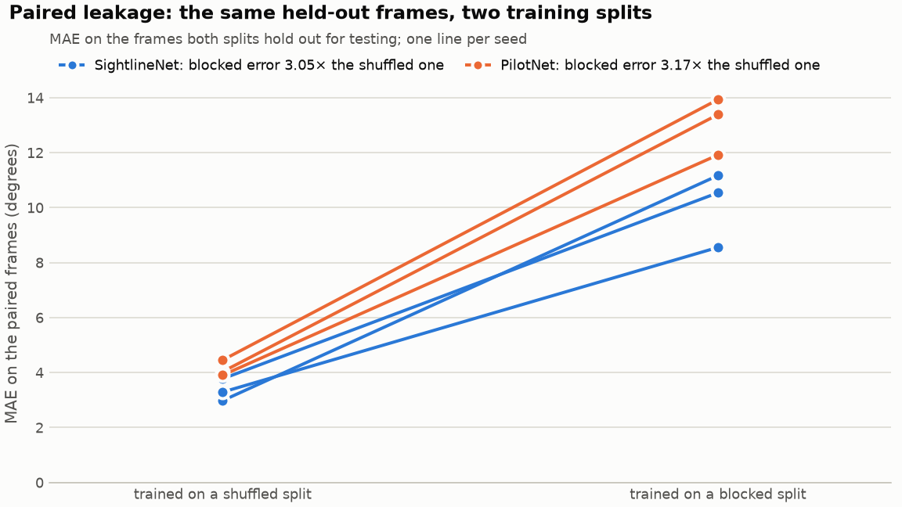
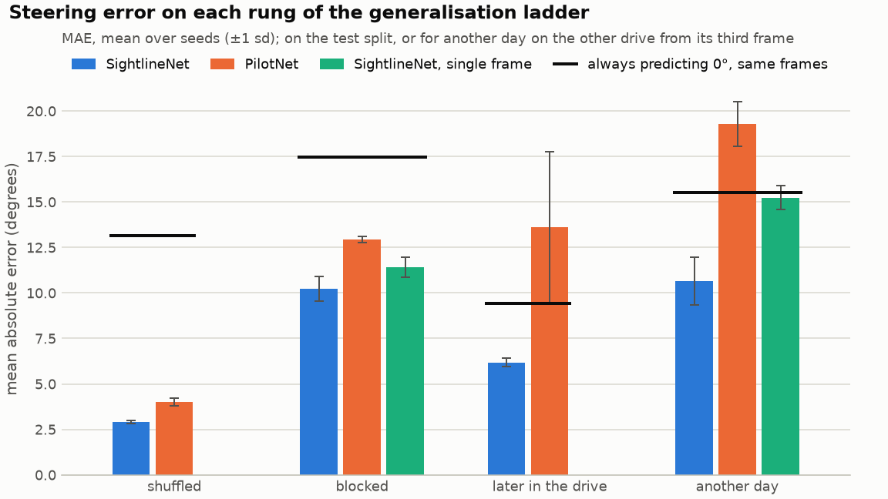
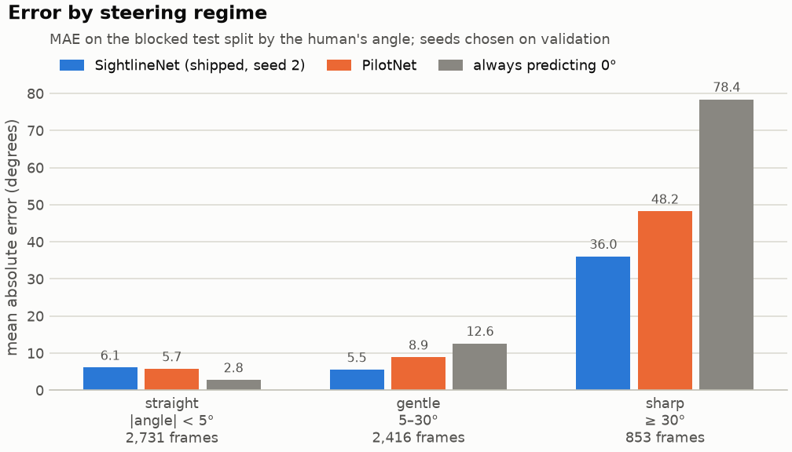

# Sightline

[](https://github.com/safdar-hussain1/sightline/actions/workflows/tests.yml)
[](https://safdar-hussain1.github.io/sightline/)
[](LICENSE)

Sightline estimates the steering-wheel angle a driver applied from a car's front camera, and
measures how far that estimate can be trusted. It trains two networks in PyTorch on a 56-minute
drive, PilotNet and SightlineNet, a compact network that sees the current frame and the frame
two before it, and tests them four ways, from the usual shuffled frame split to a drive recorded
on another day. The shipped SightlineNet runs in the browser as one ONNX graph that returns the
angle and a VisualBackProp map of where the network looked, and the page shows both beside the
human driver's own wheel. **Live demo: <https://safdar-hussain1.github.io/sightline/>**

The page opens on the demo: the model reads a 2018 clip from stretches of road it never trained
on, or a 2017 clip from another day, and turns its own wheel beside the driver's, with its
saliency heat over the road; a toggle swaps in its twin trained on shuffled frames. Below it are
how it works and one accuracy figure, and the `#results` view holds the measurements. Everything
runs in the visitor's browser.

This is research software. It must never be used to steer, assist or control a vehicle.

Every measured number in this file is read from a JSON file under [`reports/`](reports/) or from
[`web/public/data/results.json`](web/public/data/results.json), and `tests/test_docs_numbers.py`
fails if this file and those files disagree. The few other numbers, such as code constants,
versions and training times, are listed in that test with where they come from.

## Contents

- [Results](#results)
- [How it works](#how-it-works)
- [The protocols](#the-protocols)
- [Install](#install)
- [Get the data](#get-the-data)
- [Every command](#every-command)
- [View it locally](#view-it-locally)
- [Repository](#repository)
- [Tech stack](#tech-stack)
- [Limitations](#limitations)
- [Research use, data and licence](#research-use-data-and-licence)

## Results

All errors are mean absolute errors of the steering-wheel angle, in degrees. Means and standard
deviations are over three training seeds.

### The headline: shuffled test frames make a steering model look about three times better than it is

Frames a fraction of a second apart are near-duplicates: same road, same steering. Shuffle a
drive's frames before splitting them, the usual way, and almost every test frame has a training
frame right next to it. To measure what that does to the score, each network is trained twice
for each seed: once on shuffled frames and once on the blocked split, which holds whole stretches
of road out with a gap around them (see [The protocols](#the-protocols)). The two models are then
scored on the same frames, the test frames the two splits have in common: 893, 889 and 943
frames for the three seeds.

**Source:** `reports/summary.json`, `paired_leakage`.

| network | error, trained on shuffled frames | error, trained on the blocked split | blocked ÷ shuffled | per seed |
|---|---|---|---|---|
| SightlineNet | 3.35° ± 0.40° | 10.09° ± 1.36° | **3.05 ± 0.61** | 3.75, 2.60, 2.79 |
| PilotNet | 4.13° ± 0.29° | 13.08° ± 1.04° | **3.17 ± 0.14** | 3.32, 3.05, 3.13 |

On identical frames, the model that never trained near them is off by about three times as much
as the model whose training frames sat right next to them, for both networks. Put plainly:
testing on shuffled frames makes the same kind of model look about three times better than it
is on road it has not seen nearby.



### The shuffled split's defect is the score it reports

The SightlineNet trained on shuffled frames scores 2.90° ± 0.09° on its own test frames, and
7.96° ± 0.13° on another day's drive: its test score promises an error 2.74 times smaller than
it delivers. The blocked split's test score keeps its promise: 10.24° ± 0.68° on its test frames,
10.64° ± 1.30° on another day.

The model trained on shuffled frames is not worse for it. On another day it is the more
accurate of the two SightlineNets, in every seed. What the shuffled split gets wrong is the
number it reports: its test frames sit next to its training frames, so the score mostly
measures how well the model remembers that stretch of road. PilotNet differs: its model trained
on shuffled frames is worse on another day than its blocked one (21.75° ± 2.24° against
19.28° ± 1.22°), and neither beats always steering straight there (15.52°).

### How much better than always steering straight

Most driving is close to straight ahead, so a predictor that always answers 0° is a strong
baseline, and how strong depends on the frames: on the four rungs below it is off by 13.14°,
17.48°, 9.41° and 15.52°. Raw errors therefore do not compare across rungs. The table gives the
share of always-straight's error each model removes on the same frames, one minus the ratio of
the two errors: positive is better than always steering straight, negative is worse.

**Source:** `reports/summary.json`, `groups`: `test_skill` and, for another day, `cross_skill`.

| rung | scored on | SightlineNet | PilotNet | SightlineNet, one frame |
|---|---|---|---|---|
| shuffled | 9,574 shuffled test frames per seed | +78% ± 0% | +70% ± 1% | not trained |
| blocked | 6,000 test frames, at least 501 frames from training | +41% ± 4% | +26% ± 1% | +35% ± 3% |
| later in the drive | the last 9,324 frames of the drive | +34% ± 3% | −45% ± 44% | not trained |
| another day | 45,404 frames of drive2017, from frame 2 on | +31% ± 8% | −24% ± 8% | +2% ± 4% |

SightlineNet beats always steering straight on every honest rung, in every seed. PilotNet does
not, later in the drive or on another day; later in the drive its seeds disagree widely, from
+5% to −79%. The shuffled rung is not an honest test, and is here to show how far it flatters.

The same results as raw errors, next to always steering straight on the same frames:

**Source:** `reports/summary.json`, `ladder`.

| rung | always straight | SightlineNet | PilotNet | SightlineNet, one frame |
|---|---|---|---|---|
| shuffled | 13.14° | 2.90° ± 0.09° | 4.01° ± 0.21° | not trained |
| blocked | 17.48° | 10.24° ± 0.68° | 12.94° ± 0.16° | 11.42° ± 0.54° |
| later in the drive | 9.41° | 6.18° ± 0.25° | 13.63° ± 4.14° | not trained |
| another day | 15.52° | 10.64° ± 1.30° | 19.28° ± 1.22° | 15.23° ± 0.66° |

Each seed's shuffled split has test frames of its own, so the shuffled rung's always-straight
figure is the mean over the three; on every other rung all seeds are scored on the same frames.



### Two frames, not one

SightlineNet sees the current frame and the frame two before it. The same network and recipe on
the current frame alone, 287,489 parameters against 289,289, is nearly as good on the blocked
test frames (+35% ± 3% against +41% ± 4%), but only level with always steering straight on
another day (+2% ± 4%), where two frames reach +31% ± 8%. The difference between two frames
shows the car's own rotation as image motion; a single frame shows only scenery, and scenery
changes from one road to the next.

### The lookup table the shuffled split rewards

A predictor with no model at all finds the training frame that looks most like the test frame
(grey-level thumbnails compared pixel by pixel) and copies its steering label. On the same 893
paired frames of the first seed, it scores 0.64° when it searches the shuffled split's training
frames and 21.87° when it searches the blocked split's; always steering straight scores 17.31° on
those frames. Under the shuffled split, the most similar training frame is a median of 1 frame
away; under the blocked split, 12,091 frames away.

Six of those frames, from nearly straight to the sharpest turn, with the most similar training
frame under each split. Frame numbers are rows of the drive's cache and label file; time apart is
read from the drive's timestamps.

**Source:** `reports/leakage.json`, `pairs`.

| frame (human angle) | shuffled: nearest training frame | time apart | its angle | blocked: nearest training frame | time apart | its angle |
|---|---|---|---|---|---|---|
| 7,917 (0.40°) | 7,916 | 41 ms | 0.50° | 28,219 | 1,073.2 s | 1.41° |
| 8,470 (3.53°) | 8,469 | 57 ms | 3.43° | 28,187 | 1,041.1 s | 0.81° |
| 8,173 (6.96°) | 8,174 | 57 ms | 7.56° | 6,157 | 107.1 s | −85.31° |
| 29,273 (15.53°) | 29,274 | 39 ms | 15.53° | 31,160 | 102.7 s | 45.78° |
| 60,875 (76.64°) | 60,874 | 43 ms | 71.80° | 57,834 | 147.4 s | 17.55° |
| 60,913 (234.35°) | 60,912 | 30 ms | 234.25° | 21,414 | 2,065.9 s | −337.11° |

Under the shuffled split the nearest-looking training frame is always the frame next door,
steering at nearly the same angle. Under the blocked split it is minutes away, and often steering
somewhere else entirely.

### Against the baselines

The shipped model, the blocked-split SightlineNet of seed 2 (chosen on validation error), beside
the baselines on the same frames:

**Source:** `web/public/data/results.json`, `baselines`.

| predictor | blocked test frames (6,000) | another day (45,404 frames) |
|---|---|---|
| SightlineNet, the shipped run | 10.12° | 9.77° |
| always steering straight | 17.48° | 15.52° |
| always the training mean | 17.84° | 15.47° |
| oracle: the human's angle one frame earlier | 0.59° | 0.51° |
| oracle: a straight line through the human's two previous angles | 0.69° | 0.49° |

The two oracles read the human's own steering from the frames just before, the answer stream
itself, which a camera model never sees. They show how little steering changes from one frame
to the next; they are bounds, not competitors.

### Steering regimes: on straight road, always steering straight wins

The blocked test frames, binned by the human's angle; each network's seed chosen on validation
error (SightlineNet seed 2, PilotNet seed 1, the one-frame SightlineNet seed 2).

**Source:** `web/public/data/results.json`, `regimes`.

| frames | count | SightlineNet | PilotNet | SightlineNet, one frame | always straight |
|---|---|---|---|---|---|
| straight, under 5° either way | 2,731 | 6.09° | 5.74° | 6.30° | 2.76° |
| gentle, 5° to 30° | 2,416 | 5.52° | 8.87° | 8.55° | 12.60° |
| sharp, 30° or more | 853 | 36.05° | 48.21° | 40.24° | 78.41° |
| the three weighted equally | | 15.89° | 20.94° | 18.36° | 31.26° |

On straight road, always steering straight wins: every model's small wobble costs more than
answering 0°. The models earn their keep on curves, and sharp turns stay hard.



### The standard-recipe PilotNet

For comparison, a PilotNet trained the widely copied TensorFlow 1 way on drive2017, scored from
its weights through a PyTorch port. The recipe, as the report records it: *PilotNet in
TensorFlow 1: shuffled 80/20 frame split, MSE in radians plus L2, atan output head limited to
±180°*.

**Source:** `reports/legacy.json`, `eval`.

| scored on | frames | its error | always straight |
|---|---|---|---|
| its own training drive, drive2017 from frame 2 on | 45,404 | 4.48° | 15.52° |
| drive2018, the blocked test frames | 6,000 | 21.97° | 17.48° |
| drive2018, the later-in-the-drive test frames | 9,324 | 19.39° | 9.41° |

Good on its own training drive, worse than always steering straight on the 2018 drive. On the
same blocked test frames, PilotNet trained by Sightline's recipe on the blocked split scores
12.94° ± 0.16°. The arctangent head is a ceiling as well: its largest prediction is 169.8°,
while 235 labels in drive2018 turn the wheel past 180°. Once every prediction is made, 192 of
them are computed again by an independent NumPy implementation of the TensorFlow graph; the
largest difference is 2.2e-04°.

### From PyTorch to the browser

Each model the page runs was exported to ONNX and checked with onnxruntime against PyTorch on
every clip frame and self-test input the page uses, before it was written.

**Source:** `reports/export.json`, `models`.

| file | run | size | frame stacks checked | largest angle difference | largest saliency difference |
|---|---|---|---|---|---|
| `sightline.onnx` | `drive2018_sightlinenet_blocked_s2` | 1,170,713 bytes | 848 | 1.8e-04° (gate 0.0005°) | 7.5e-06 (gate 0.0001) |
| `sightline-shuffled.onnx` | `drive2018_sightlinenet_leaky_s2` | 1,170,711 bytes | 848 | 1.3e-04° (gate 0.0005°) | 8.2e-06 (gate 0.0001) |

In the browser the page checks itself. While the demo runs, it compares every angle the
browser computes with the angle onnxruntime computed in Python on the same decoded frames, and
says whether they match; `?selftest=1` runs the full check and writes its verdict into the tab
title.

## How it works

1. **Two frames.** Each camera frame, 455 × 256 pixels, is cut to its bottom 150 rows (road, not
   sky) and resized to 200 × 66 in RGB. The model takes the current frame t and frame t−2,
   stacked along the channels into one uint8 array of 66 × 200 × 6. On drive2018, whose frames
   carry timestamps a median 57.0 ms apart, that is 114 ms of driving.
2. **One network.** SightlineNet is five convolutions with batch normalisation and SiLU on
   PilotNet's convolution geometry, a flatten that keeps where things are left and right, and a
   small fully connected head with a linear output in degrees. A linear head, not PilotNet's
   arctangent, because the drives' labels go past ±180°. It has 289,289 parameters; PilotNet
   has 1,595,511.
3. **One graph, two answers.** The exported ONNX graph returns the steering angle and a
   VisualBackProp saliency map from the same forward pass. VisualBackProp averages each
   convolution's activations over its channels and multiplies them from the deepest layer back
   to the input, so only the regions that stay active through the whole stack light up.
   Normalisation is inside the graph, so the browser feeds it the raw uint8 pixels it decodes,
   and no preprocessing runs in JavaScript.
4. **In the browser.** onnxruntime-web runs the graph on one WebAssembly thread. The footage
   and the models are static files on the page; nothing is uploaded.

**The multi-frame caveat.** The second frame makes the input depend on timing. The model learned
what the motion between frames 114 ms apart looks like on drive2018. drive2017 has no timestamps
and is taken to run at the same rate, because its motion and steering signatures match. Frames
from another camera, at another rate, across a dropped frame or a cut in the footage change what
that motion means, and the model has no way to tell. The first two frames of a sequence have no
history: evaluation starts at frame 2, and each demo clip carries the two frames before its
first scored frame.

The model is trained with a Huber loss on the angle in units of 30°, AdamW at a learning rate of
0.0003 on a 20-epoch cosine schedule, weight decay 0.0001 and batches of 128. Augmentation flips
the frames with the angle negated and varies brightness, contrast, shadows, position, colour,
noise and occlusion, every draw but the per-pixel noise applied to both frames alike, so it
never fakes motion between them, with dropout 0.3 before the head;
the checkpoint with the lowest validation error is kept. PilotNet gets the lighter standard
augmentation and dropout 0.2.

## The protocols

Every run trains on drive2018: 63,825 frames, 55.9 minutes, a timestamp on every frame. Its
labels have 368 single-frame sensor dropouts, a logged zero between two large steering angles of
the same sign, repaired by interpolating their neighbours (268 in drive2017).

- **Shuffled** (`--protocol leaky`): shuffle the frames, then deal 70% to training, 15% to
  validation and 15% to test: 44,677, 9,574 and 9,574 frames. 90.9% of the test frames sit within
  one frame of a training frame. This is the standard failure mode, reproduced on purpose so it
  can be measured.
- **Blocked** (`--protocol blocked`, the honest headline): cut the drive into blocks of 1,500
  frames, dealt by the repeating pattern `TTVTTET` (T train, V validation, E test), and drop 250
  frames on each side of every boundary between a training block and an evaluation block. Every
  evaluation frame is then at least 501 frames from a training frame, twice the firewall plus
  one, about 28.6 s of driving, while both sides of the split see the same mix of roads: 39,825
  training, 6,000 validation and 6,000 test frames, 12,000 dropped.
- **Later in the drive** (`--protocol forward`): train on the first 70% of the drive, validate on
  the next 15% and test on the rest, with the same 250-frame firewall at both boundaries: 44,427,
  9,074 and 9,324 frames, 1,000 dropped. Its test frames are at least 10,075 frames from training.
  This rung adds a change of road: the end of the drive is calmer than its middle, which is why
  always steering straight is off by only 9.41° there.
- **Another day**: the blocked-split models scored on drive2017, recorded on a different day:
  45,404 of its 45,406 frames, every frame from frame 2 on, since the first two have no history.
- **The paired set**: the frames that both the blocked split and a seed's shuffled split hold out
  for testing, so the two models of a seed are compared on identical frames: 893, 889 and 943
  frames for the three seeds.

The 21 runs are PilotNet and SightlineNet under the three splits and the one-frame SightlineNet
under the blocked split, each for three seeds. Every published number comes from the CPU.

## Install

Python 3.10 or newer.

```bash
git clone https://github.com/safdar-hussain1/sightline.git
cd sightline
python3 -m venv .venv
.venv/bin/pip install -e '.[dev]'
```

`dev` brings everything the tests need: pytest, onnx and onnxruntime, and matplotlib. The
optional extras on their own are `export` (onnx and onnxruntime, for `export` and `site-data`),
`figures` (matplotlib, for `figures`) and `notebooks` (Jupyter's nbconvert and ipykernel, and
matplotlib).

On Linux, pip's default PyTorch wheel pulls in the CUDA libraries, several gigabytes. Without an
NVIDIA GPU, install the CPU-only wheel first, then the package:

```bash
.venv/bin/pip install torch --index-url https://download.pytorch.org/whl/cpu
.venv/bin/pip install -e '.[dev]'
```

The tests need no dataset: they run on synthetic drives and the committed reports.

## Get the data

The two drives are the Sully Chen driving datasets: <https://github.com/SullyChen/driving-datasets>.
That page links both downloads: the 2018 drive, listed as "07/01/2018 Dataset", with a timestamp
on every frame ([download](https://drive.google.com/open?id=1PZWa6H0i1PCH9zuYcIh5Ouk_p-9Gh58B)),
and the 2017 drive, listed as "Dataset 1"
([download](https://drive.google.com/file/d/1Ue4XohCOV5YXy57S_5tDfCVqzLr101M7/view?usp=sharing)).
Unzip each into its own folder, so that the folder holds the JPEG frames and their `data.txt`
directly:

```text
data/
  drive2018/   0.jpg, 1.jpg, ... and data.txt   (lines: filename.jpg angle,date time)
  drive2017/   0.jpg, 1.jpg, ... and data.txt   (lines: filename.jpg angle)
```

Then check them against the label files every result here was measured on:

```bash
sightline data verify
```

It compares each `data.txt` with its published SHA-256 and frame count (63,825 and 45,406 labelled
frames) and checks that every labelled frame has its image.

## Every command

From the repository root, with the environment active (`source .venv/bin/activate`). Every line
was run against this repository; the comments say what each writes.

```bash
# the data: check it, then preprocess each drive once into runs/cache/
sightline data verify
sightline cache --drive drive2018
sightline cache --drive drive2017

# train one run, the shipped one, as the matrix ran it: SightlineNet, blocked split, seed 2, full cosine schedule,
# no early stopping (the firewall and block are the defaults, written out)
sightline train --drive drive2018 --model sightlinenet --protocol blocked --seed 2 --epochs 20 --patience 0 --firewall 250 --block 1500
# or every run of the matrix, three at a time (--dry-run lists what it would do)
python scripts/train_matrix.py --parallel 3 --epochs 20 --patience 0

# score every finished run on the CPU (reports/runs/), combine the seeds (reports/summary.json), draw the figures
sightline eval --all
sightline report
sightline figures

# the leakage analysis (reports/leakage.json)
sightline leakage --drive drive2018 --seed 0
# the standard-recipe PilotNet (reports/legacy.json), from its TensorFlow 1 weights saved as an .npz
sightline legacy --weights PATH/TO/WEIGHTS.npz

# everything the page loads (web/public/models/, web/public/data/) and its record (reports/export.json)
sightline site-data
# the cockpit as a video: the 2018 demo clip, rendered on the CPU
sightline demo --drive drive2018 --run drive2018_sightlinenet_blocked_s2 --start 28752 --frames 420 --out demo.mp4

# the notebooks (the notebooks extra): the results one needs only the reports, the data one the dataset and its caches
jupyter nbconvert --to notebook --execute --inplace --ExecutePreprocessor.record_timing=False notebooks/02-results.ipynb
jupyter nbconvert --to notebook --execute --inplace --ExecutePreprocessor.record_timing=False notebooks/01-data-and-leakage.ipynb

# the page
npm --prefix web ci
npm --prefix web test
npm --prefix web run build
npm --prefix web run preview
```

Then open <http://localhost:4173/> for the page and <http://localhost:4173/?selftest=1> for its
self-test.

What to expect:

- Training is the only long step. On an Apple M1 Pro GPU (PyTorch's MPS backend), with up to three
  runs sharing it, one run took from 24 to 64 minutes by its own history; the shipped run took 53
  minutes. A run is never trained twice: `train` refuses an existing run without `--overwrite`, and the matrix
  skips finished runs.
- `eval --all` skips a run whose report already describes its checkpoint; `--overwrite`
  evaluates every run again.
- Run again on the same machine with the same library versions, `report`, `figures`, `leakage`
  and both notebooks reproduce their committed files byte for byte. `eval`, `legacy` and
  `site-data` also record the commit they ran at, so that field changes; run again here,
  `eval` on the shipped run and `legacy` reproduced every other value in their reports, and
  `site-data` every model and clip the page loads and every value in its results. `record_timing=False` keeps run
  timestamps out of the notebooks.
- The weights of the standard-recipe PilotNet are not part of this repository, so `legacy` runs
  only where you have them (`--weights`, or the `SIGHTLINE_LEGACY_WEIGHTS` variable).
- `site-data` encodes the clips with ffmpeg; `--no-video` writes everything else.

## View it locally

The page is the static build in `docs/`, which GitHub Pages serves. Build it and serve it with
Vite's preview server:

```bash
npm --prefix web ci
npm --prefix web run build
npm --prefix web run preview
```

Then open <http://localhost:4173/>. Use the preview server rather than `python3 -m http.server`:
the demo clips are videos the page seeks in, and seeking needs HTTP range requests, which
Python's simple server does not answer. Opening `docs/index.html` as a file does not work either:
browsers block the page's modules, models and WebAssembly runtime on `file://`.

<http://localhost:4173/?selftest=1> runs the page's self-test: both models, on the committed
self-test inputs and on the clips' frames, against the outputs onnxruntime computed in Python. The
verdict is the tab title, starting `PASS` or `FAIL`.

## Repository

```text
src/sightline/
  data/             label parsing and dropout repair, the frame cache, the split protocols, dataset checks
  models/           PilotNet, SightlineNet, and the shared input adapter that takes raw uint8 frames
  train.py          seeded training: Huber loss, AdamW, cosine schedule, best-validation checkpoint
  evaluate.py       metrics, baselines and steering regimes
  reporting.py      one report per run, and the summary over seeds
  leakage.py        how close test frames sit to training frames, in time and in pixels; the lookup table
  legacy.py         the standard-recipe PilotNet: its TensorFlow 1 weights, an independent NumPy graph, its scores
  saliency.py       VisualBackProp in plain tensor operations, so it exports with the model
  export/           the ONNX export with measured parity, and the data the page loads
  demo.py           a stretch of a drive rendered as a cockpit video
  figures.py        the three figures in reports/figures/
  cli.py            the sightline command
scripts/            train_matrix.py, which trains the matrix a few runs at a time
reports/            every published number, as JSON, and the figures drawn from them
notebooks/          01-data-and-leakage.ipynb (needs the dataset) and 02-results.ipynb (reports only)
tests/              the Python suite, including the guards over the repository and its documents
web/                the page: index.html, src/ (TypeScript), public/ (the models, the clips, results.json, the model card)
docs/               the published site, built by npm --prefix web run build
```

## Tech stack

- **Python 3.10+**: PyTorch for the models and training, NumPy, OpenCV for decoding and
  resizing, Pillow and tqdm; ONNX and onnxruntime for the export; matplotlib for the figures;
  Jupyter for the notebooks; pytest.
- **Browser**: TypeScript built with Vite, onnxruntime-web on WebAssembly, tested with Vitest.
  No UI framework.
- **ffmpeg** encodes the demo clips.

The full dependency list and its version ranges are in [`pyproject.toml`](pyproject.toml) and
`web/package.json`. The model card is [`web/public/model-card.md`](web/public/model-card.md).

## Limitations

- **One car, one camera.** Both drives were recorded from the same car's dashcam, in daylight,
  around Rancho Palos Verdes and San Pedro in Southern California (the dataset page names the
  places). Nothing here says how the model does at night, in rain, on another car or in another
  place.
- **Open loop only.** Every score compares the model's angle with what the human did, frame by
  frame. The model never steered, so its errors never compound, and nothing here says how it
  would drive.
- **Single-frame models do not beat always steering straight away from the training stretches.**
  PilotNet is worse than always straight later in the drive (−45% ± 44%) and on another day
  (−24% ± 8%); the one-frame SightlineNet is level with it on another day (+2% ± 4%).
- **Sharp turns stay hard.** On frames steered 30° or more, the shipped model is off by 36.05°.
- **A small paired set.** The headline ratio rests on 893, 889 and 943 frames of one drive and on
  three seeds, and SightlineNet's ratio varies from seed to seed (3.05 ± 0.61).
- **The 2018 demo clip and the twin.** The twin trained on shuffled frames trained on 71% of the
  2018 clip's frames, and 97% of them sit within one frame of a frame it trained on, so on this
  clip it looks better than the shipped model (5.63° against 14.26° on this clip). On the 2017
  clip, which neither model trained on, the twin is off by 14.17° on this clip and the shipped
  model by 10.78°.
- **A clip's error describes the clip.** Each clip is the window with the most steering that
  stays within road-following angles, chosen from the human's labels before any model ran, so it
  is harder than an average stretch.
- **Saliency is not an explanation.** VisualBackProp shows where activations survive through the
  network, not why it chose an angle.

## Research use, data and licence

Sightline is research and teaching software. It estimates, from recorded footage, the steering
angle a human applied. It must never be used to steer, assist or control a vehicle, in any form.
The dataset's author asks the same: the dataset page says the data is "purely for research and
statistics" and that no one should ever pilot a car with software trained on it.

**Data.** The two drives are the [Sully Chen driving datasets](https://github.com/SullyChen/driving-datasets),
released under the MIT License, Copyright (c) 2018 Sully Chen, as that repository's `LICENSE`
file states; the downloaded dataset folders carry no licence file of their own. The demo clips
and frame images under `web/public/data/` are excerpts of those drives, and the two ONNX models
under `web/public/models/` were trained on them; both are published for research use only, as
the dataset's author asks. The datasets themselves are never committed here.

**Code.** MIT, see [LICENSE](LICENSE).

**References.** PilotNet: Bojarski et al., *End to End Learning for Self-Driving Cars*,
[arXiv:1604.07316](https://arxiv.org/abs/1604.07316). VisualBackProp: Bojarski et al.,
*VisualBackProp: efficient visualization of CNNs*, [arXiv:1611.05418](https://arxiv.org/abs/1611.05418).
